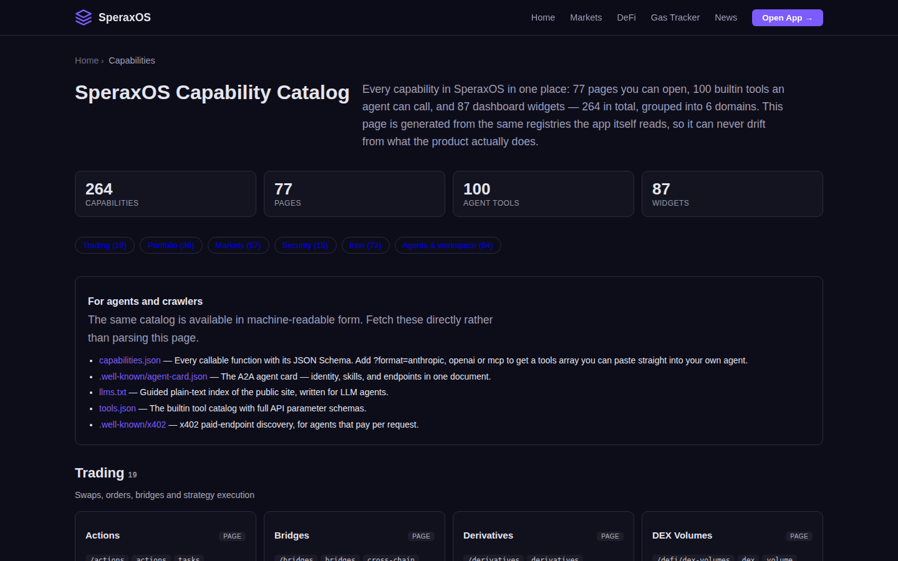
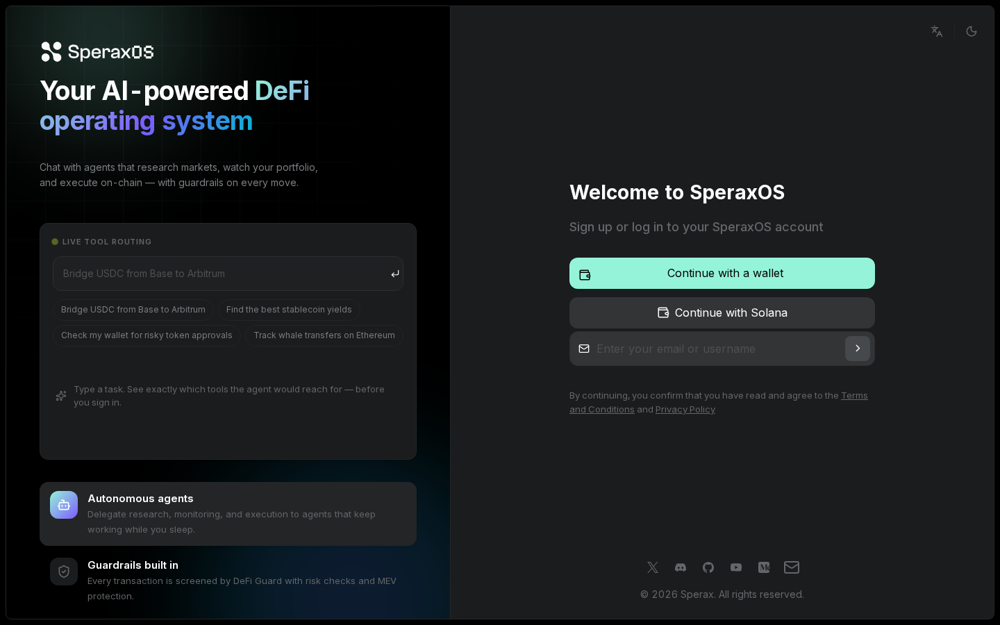

# SperaxOS Docs

Documentation, how-tos, tutorials and snippets for [SperaxOS](https://chat.sperax.io), the open-source AI agent workspace for on-chain DeFi. This repository contains no application code. The source lives at [nirholas/sperax](https://github.com/nirholas/sperax).

## Contents

| Area | Start here |
| --- | --- |
| Desktop app | [Install and run](docs/desktop/install.md), [build from source](docs/desktop/build-from-source.md), [troubleshooting](docs/desktop/troubleshooting.md) |
| Android | [Android release](docs/desktop/android.md) |
| Agent discovery | [Overview](docs/discovery/README.md), [x402](docs/discovery/x402.md), [agent card](docs/discovery/agent-card.md), [MCP](docs/discovery/mcp.md), [llms.txt](docs/discovery/llms-txt.md), [security.txt](docs/discovery/security-txt.md) |
| Prompts | [Writing task prompts](docs/prompts/task-prompts.md) |
| Tutorials | [Call SperaxOS from an agent](docs/tutorials/call-from-an-agent.md), [Verify a deployment's discovery surface](docs/tutorials/verify-discovery.md) |
| Snippets | [`snippets/`](snippets/README.md): curl and JavaScript examples |

## Screenshots

These are captures of the production web app at <https://chat.sperax.io>. The desktop app wraps the same renderer. They are not captures of a native desktop window, because no desktop installer has been published yet.

| Capability catalog | Sign in |
| --- | --- |
|  |  |

| How it works |
| --- |
|  |

## Scope

In scope: how to install, build and use the desktop app; how agents discover and call SperaxOS; prompt-writing guidance; runnable snippets.
Out of scope: application source code, secrets, and anything that is not verifiable against the public product.

## Status of downloads

Desktop installers (macOS, Windows, Linux) are not published yet. Until they are, build from source. The latest published release is the Android build, [`mobile-v1.0.1`](https://github.com/nirholas/sperax/releases/tag/mobile-v1.0.1). The download page at <https://chat.sperax.io/download> lists installers as soon as a desktop release exists.

## Contributing

See [CONTRIBUTING.md](CONTRIBUTING.md). Report security issues as described in [SECURITY.md](SECURITY.md).

## License

Apache-2.0. See [LICENSE](LICENSE).
